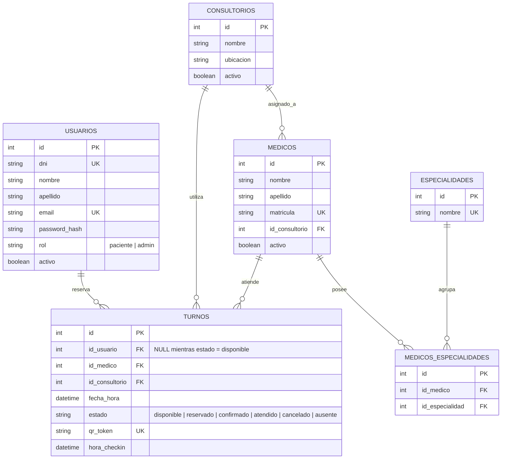
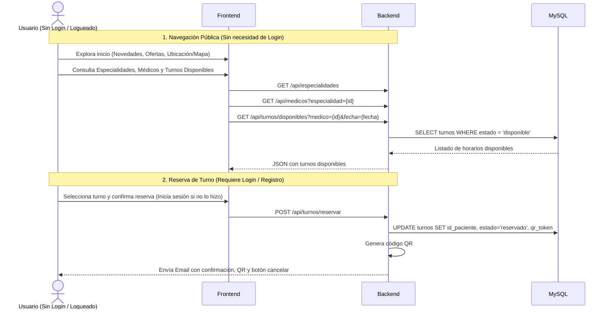
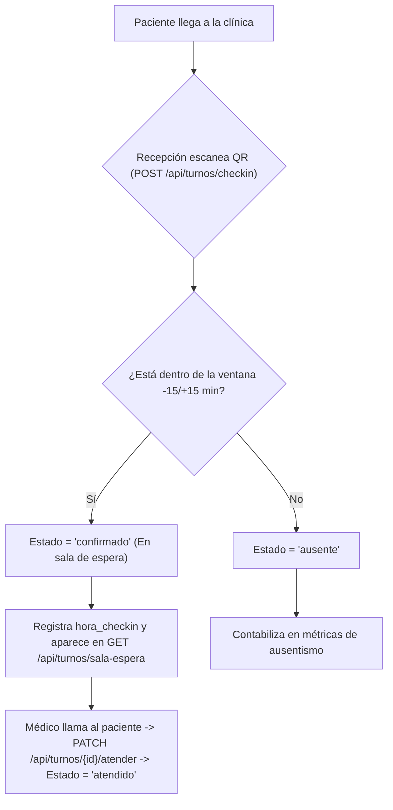

# Diagramas del Sistema

## Esquema de Base de Datos (ERD)
Obligatorio: Se utiliza un único campo `datetime` para la fecha y hora del turno, y no campos separados.

### Decisiones de Diseño en el Modelo de Datos:
1. **Unificación de Usuarios y Pacientes en `USUARIOS`:** Se unifican los datos de cuenta/autenticación (`email`, `password_hash`, `rol`) y los datos personales (`dni`, `nombre`, `apellido`, `activo`) en una única tabla `USUARIOS`. Mediante el campo `rol` se distingue únicamente entre `paciente` y `admin` (personal de la clínica que opera tanto recepción/check-in como la administración y ABMs).
2. **Tabla intermedia `MEDICOS_ESPECIALIDADES` (Relación N:M):** Se agrega la tabla intermedia entre `MEDICOS` y `ESPECIALIDADES` para permitir que un médico atienda una o más especialidades y una especialidad cuente con múltiples médicos (estructura equivalente si se vincula con `OBRAS_SOCIALES`).

> **Alternativa / Extensión con Obras Sociales:** Si el equipo decide que la tabla intermedia adicional sea por Coberturas Médicas (`OBRAS_SOCIALES`), se mantiene el mismo patrón relacional mediante `OBRAS_SOCIALES (id PK, nombre UK, activo)` y la tabla intermedia `MEDICOS_OBRAS_SOCIALES (id PK, id_medico FK, id_obra_social FK)`.

Los valores posibles de `TURNOS.estado` son `disponible`, `reservado`, `confirmado`,
`atendido`, `cancelado` y `ausente`. Administración genera las franjas en estado `disponible` mediante `POST /api/turnos` y los usuarios pueden consultarlas públicamente sin iniciar sesión mediante `GET /api/turnos/disponibles`.

## Flujo de Consulta Pública y Reserva de Turnos

## Flujo de Check-in en Recepción

