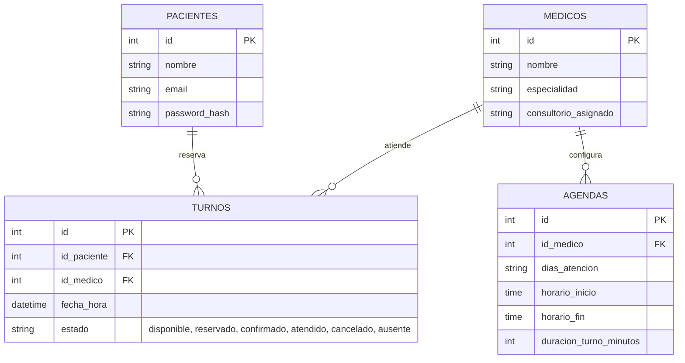
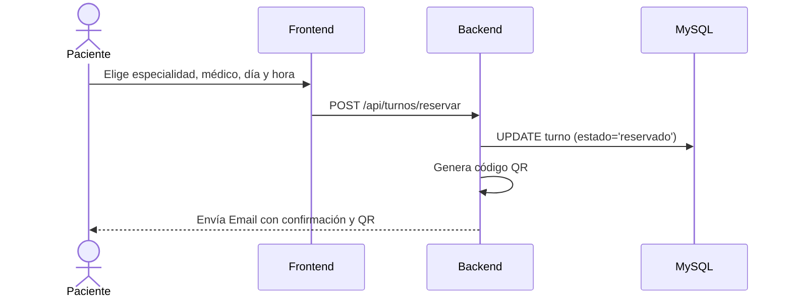
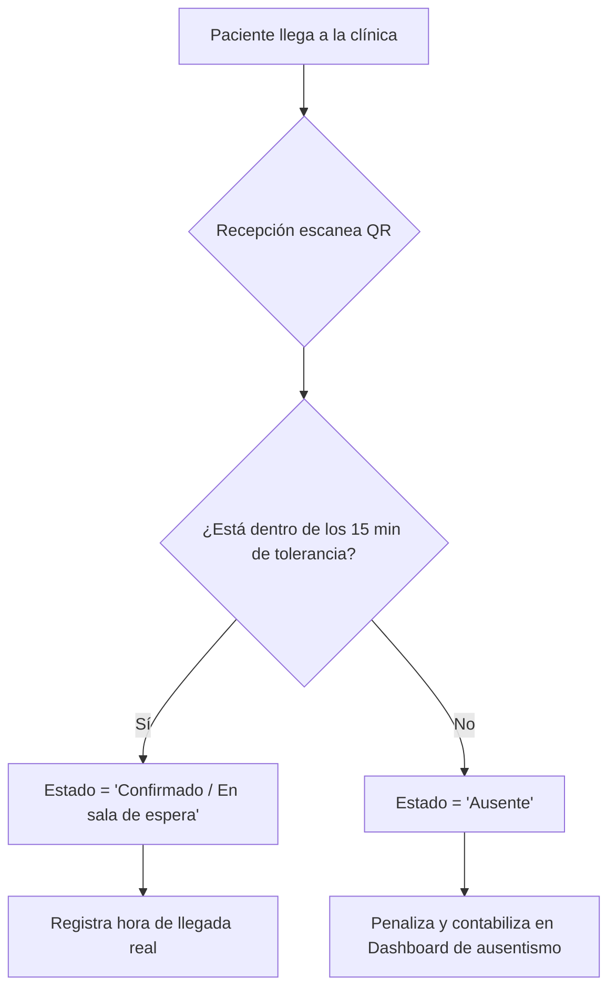

# Diagramas del Sistema

## Esquema de Base de Datos (ERD)
Obligatorio: Se utiliza un único campo `datetime` para la fecha y hora del turno, y no campos separados.

## Flujo de Reserva de Turnos

## Flujo de Check-in en Recepción

