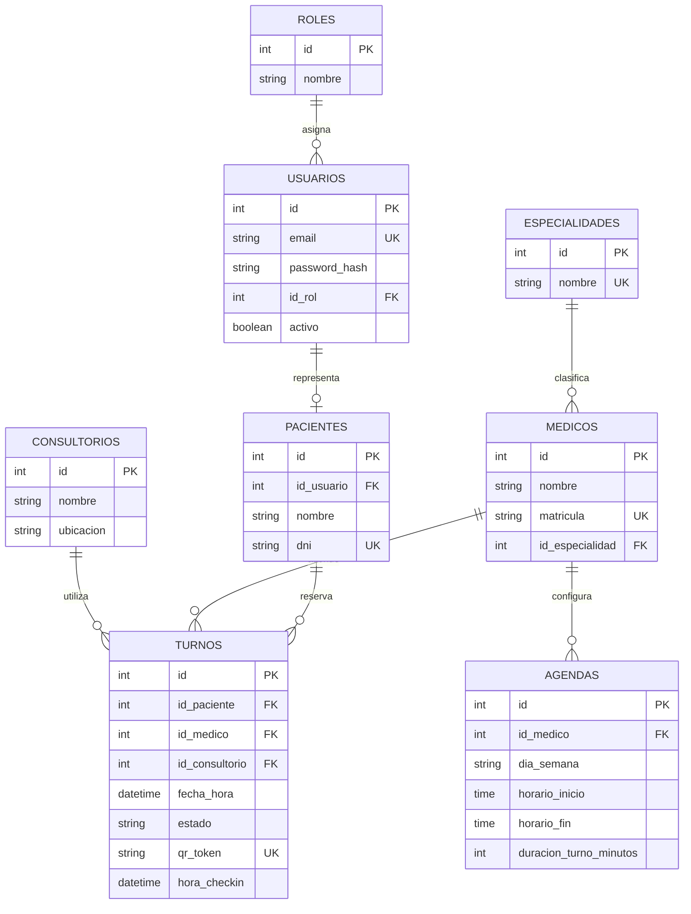
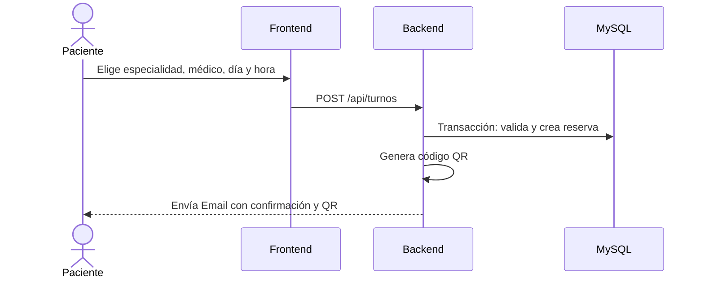
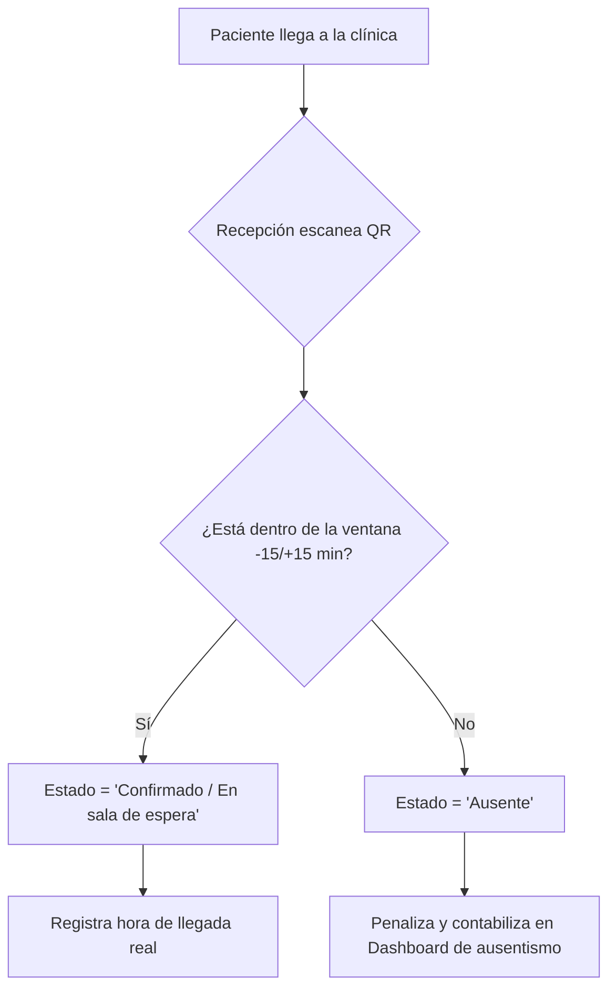

# Diagramas del Sistema

## Esquema de Base de Datos (ERD)
Obligatorio: Se utiliza un único campo `datetime` para la fecha y hora del turno, y no campos separados.

Los valores posibles de `TURNOS.estado` son `disponible`, `reservado`, `confirmado`,
`atendido`, `cancelado` y `ausente`. La disponibilidad puede calcularse a partir de
`AGENDAS` y de los turnos existentes; no es necesario persistir una fila por cada
franja libre.

## Flujo de Reserva de Turnos

## Flujo de Check-in en Recepción

